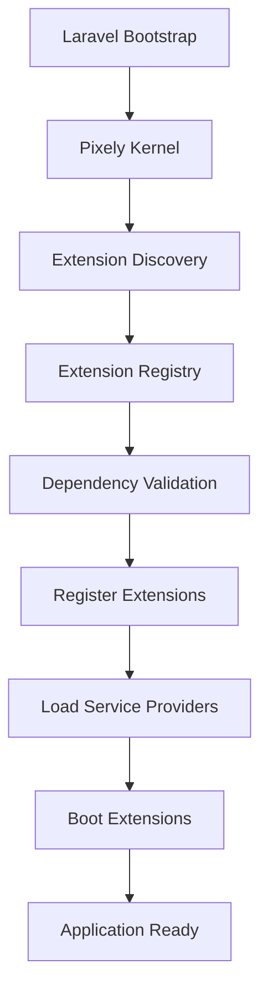

> _This page is generated from [`docs/architecture/diagrams/boot-process.md`](https://github.com/jessyjames005/Pixely-Platform/blob/develop/docs/architecture/diagrams/boot-process.md). Edit it in the repository, not in the wiki: wiki edits are overwritten._

# Boot Process Diagram

